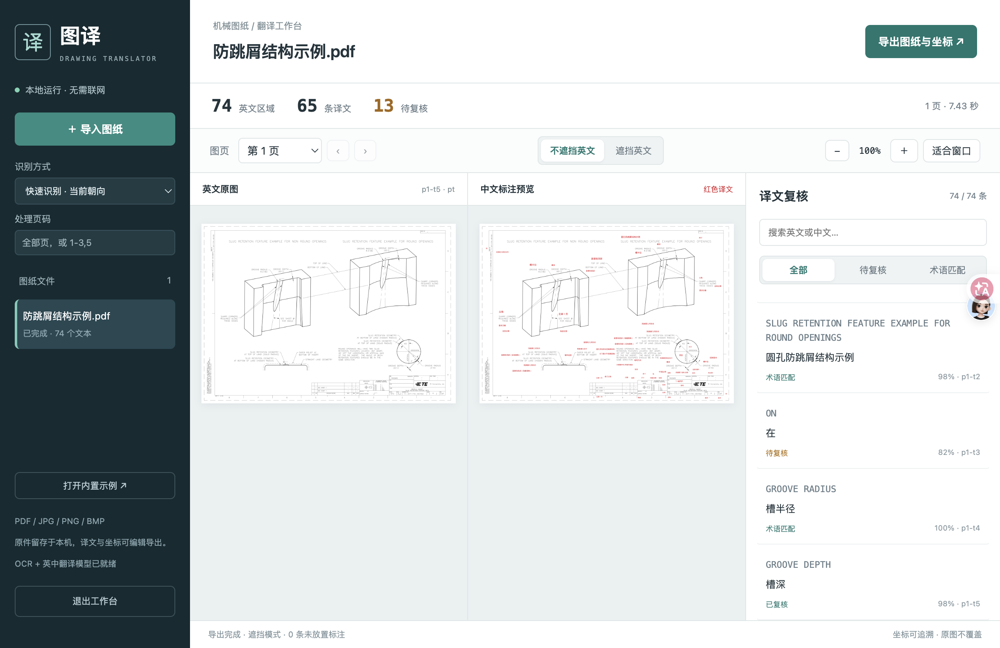

# 图译：英文零件图纸术语自动翻译

> 公开比赛复盘仓库。源码与验证记录在 Git 中；可执行程序、模型、完整样例结果在 [v1.0.0 Release](https://github.com/ShanHuiSir/drawing-translator-competition/releases/tag/v1.0.0)。
>
> 建议先看 [比赛复盘](RETROSPECTIVE.md)、[原始任务书](docs/原始任务书.txt) 和 [实测报告](docs/图译_交付说明与实测报告.pdf)。



## 演示视频（补充交付）

[视频补充材料 v1.0.1](https://github.com/ShanHuiSir/drawing-translator-competition/releases/tag/v1.0.1) · [直接下载 MP4](https://github.com/ShanHuiSir/drawing-translator-competition/releases/download/v1.0.1/drawing-translator-demo.mp4)

约 2 分 59 秒，1080p，中文神经配音与字幕。按业务问题、输入、处理、查看、导出展开真实连续操作。另附 [解说词](docs/演示解说词.md)、[视频说明](docs/视频说明.md)、[SRT](docs/图译_演示字幕.srt) 与 [验收报告](docs/视频验收报告.json)。制作过程见 [脚本归档](retrospective/video-production/README.md)。

本视频使用比赛开发样例，人工输入“复核示例”标记只演示修订流程。界面实际显示 74 个文本区域、65 条译文、8.32 秒，不能据此声明指定硬件 5 秒性能达标。视频完整解码和本次真实导出文件已核验。v1.0.0 的程序/模型包保留交付基线；v1.0.1 提供新视频与相关说明；完整整包可运行 `python scripts/restore_submission.py` 重建，下载内容全部按提交清单校验。

## 下载交付文件

[v1.0.0 Release](https://github.com/ShanHuiSir/drawing-translator-competition/releases/tag/v1.0.0) 中提供：`windows-portable.zip`（免安装程序）、`source-models.zip`（源码与模型、原始输入）、`sample-results-139-pages.zip`（完整样例结果）、`delivery-report.pdf`（实测报告）、`delivery-manifest.json`（校验清单）。压缩包内部保留中文文件名。

## 从 GitHub 恢复运行环境

```sh
git clone https://github.com/ShanHuiSir/drawing-translator-competition.git
cd drawing-translator-competition
python3 scripts/fetch_assets.py
```

上述恢复脚本仅在安装阶段联网，从固定 Release 下载源码及模型包并校验 SHA-256，恢复 models 和 inputs；运行应用仍完全离线。也可以先手动下载，再运行 `python scripts/fetch_assets.py --archive 源码包路径.zip`。

macOS：运行 `sh scripts/install_macos.sh`，再双击 `启动图译.command`。Windows：直接使用 Release 的免安装版，或安装 Python 3.12 后运行 `scripts\install_windows.bat`，再双击 `启动图译.bat`。

测试：安装依赖后运行 `python -m pip install pytest httpx psutil`，再运行 `python -m pytest -q`。模型恢复是 OCR/翻译测试的前置步骤。实测记录见 [evidence](evidence/)。

Python 本地应用，支持扫描 PDF、文本 PDF、JPG、PNG、BMP，提供英文识别、中文翻译、原文坐标、红色标注、逐条修订与批量导出。运行时不使用外部 API，不上传图纸或 OCR 文本。

## Windows 免安装启动

1. 将 Release 的 `windows-portable.zip`（本地交付名 `图译_Windows免安装版.zip`） **完整解压**到可写目录，例如 `D:\图译`。
2. 双击 `图译.exe`，默认浏览器会打开本地工作台。也可双击 `启动图译.bat` 查看控制台提示。
3. 点击“打开内置示例”或“导入图纸”。页码留空处理全部页；`1-3,5` 仅处理指定页。
4. 在右侧复核译文。点击文本条目可定位原文，修改后点击“保存并标为已复核”。
5. 选择“不遮挡英文”或“遮挡英文”，点击“导出图纸与坐标”。下载 ZIP 包含译文图纸、JSON 和 CSV。

全部依赖、英文 OCR 模型、英中翻译模型都已打包。无需安装 Python，无需申请 API。Windows 包为 x86-64，目标 Windows 10/11；在本次 macOS 环境完成组装和静态检查，**尚未在 Windows 真机执行验收**。

## 本机 macOS 启动

Git 克隆后先恢复模型，再安装环境。源代码包重新安装时运行：

```sh
sh scripts/install_macos.sh
```

安装依赖需要网络；运行、识别、翻译和导出均离线。关闭工作台请点击左下“退出工作台”；仅关闭浏览器页面不会结束后台进程。

## 源代码与测试

Python 3.10+；交付测试使用 Python 3.12。开发依赖与源码安装：

```sh
python -m pip install -r requirements.txt
python -m pip install --no-deps -e .
python -m pip install pytest httpx psutil
python -m pytest -q
python scripts/evaluate.py
```

批量执行并输出两种标注模式：

```sh
python -m drawing_translator.cli inputs --output outputs/batch --mode both --no-cache
```

`--quality accurate` 启用四方向和高分辨率切片。标准性能实测必须加 `--no-cache`；不能以第二次缓存处理冒充首次识别性能。

## 数据保存位置

工作台写入启动目录下 `workspace`：`jobs` 保存上传副本与已修订结果；`logs` 保存每日 JSONL 操作日志；`cache` 保存可重建的 OCR 提取缓存。日志不自动删除，支持保留至少 180 天。可通过 `DRAWING_DATA_DIR` 指定其他可写目录。

PDF 坐标单位是 pt，1 pt = 1/72 英寸；图像坐标单位是 px。JSON 的 `bbox` 采用显示页左上角原点，`coordinates.MinX/MinY/MaxX/MaxY` 采用任务书的左下角原点。旋转 PDF 统一到实际显示方向，原始页尺寸和视觉比例保持。

## 验收口径

交付包含实际功能测试、6 份 / 139 页样例结果和开发参考答案验证。甲方“≥50 份完整图纸、≥95% 专业翻译准确率、i7/16 GB 单图纸 ≤5 秒、72 小时稳定性、Windows 10/11 真机兼容”是独立验收条件，本次不冒充已经全部通过。详见随附实测报告。

本项目包含通用离线机器翻译；待复核标记必须由工程人员确认。源码采用 AGPL-3.0-or-later，第三方模型许可与署名详见 `THIRD_PARTY_NOTICES.md`。
